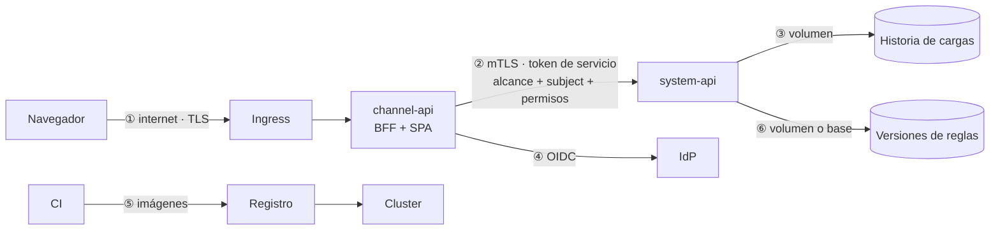

# Modelo de amenazas

**Versión:** Fase 14 · **Fecha:** 2026-09-15 · **Método:** STRIDE por frontera de confianza

Cada amenaza lleva el control que la mitiga y **la evidencia de que el control
existe**: un test, un archivo de configuración o una verificación en vivo. Un control
sin evidencia no cuenta.

## Qué se protege

| Activo | Por qué importa |
|---|---|
| **Inventario con vulnerabilidades por aplicación** | Las listas de CVEs y librerías vulnerables por EAI son un mapa de qué atacar primero |
| **Historia de cargas publicadas** | Es la base de decisiones de inversión; alterarla es alterar esas decisiones |
| **Reglas de scoring** | Deciden el score de todo el portafolio: cambiar un peso reordena la prioridad de inversión de cada aplicación sin tocar un solo dato |
| Sesiones de usuario | Quien tiene una sesión actúa con los permisos de su dueño |
| Token de servicio | Quien lo tiene llama a la capa System y puede declarar cualquier alcance |
| Llaves de Data Protection | Cifran cookies y tickets de sesión |
| Cadena de suministro | Una dependencia o imagen comprometida corre con los permisos del servicio |

## Fronteras de confianza

---

## ① Navegador → channel-api

| | Amenaza | Control | Evidencia | Riesgo residual |
|---|---|---|---|---|
| **S** | Robo de sesión por XSS | BFF: cookie `httpOnly`, sin tokens en el navegador · CSP sin `unsafe-inline` ni orígenes de terceros · `dangerouslySetInnerHTML` prohibido por lint | `SessionCookieIsHttpOnlySecureAndStrict` · `ShellIsServedWithAStrictContentSecurityPolicy` · `eslint.config.js` | Un XSS aún podría actuar *dentro* de la página; la CSP sin inline lo hace muy difícil |
| **S** | Cookie copiada (proxy, volcado, equipo compartido) | Sesión en el servidor: logout la elimina · 30 min de inactividad · 12 h absolutas | `LogoutInvalidatesACopiedCookie` · `SessionExpiresAfterThirtyMinutesWithoutActivity` · `AnActiveSessionStillExpiresAfterTwelveHours` | Hasta 30 minutos si nadie cierra sesión |
| **S** | Fijación de sesión | `SameSite=Strict`: el callback OIDC es cross-site y no lleva la cookie previa | `LoginsWithoutAPreviousCookieCreateIndependentSessions` · [ADR 0011](../adr/0011-la-sesion-vive-en-el-servidor.md) | Depende de no relajar `Strict` |
| **S** | IP falsificada para esquivar límites | `X-Forwarded-For` solo de proxies declarados | `Program.cs` (`ForwardedHeadersOptions`) | La lista de proxies se configura por entorno |
| **T** | CSRF sobre una mutación | `SameSite=Strict` + doble envío de token | `MutationWithoutACsrfTokenIsRejected` · `UploadWithoutCsrfTokenIsRejected` · `PublishingWithoutTheCsrfTokenIsRejected` | — |
| **T** | Ampliar el alcance o los permisos con un header | La Channel borra y recalcula `X-Portfolio-Scope` y `X-Portfolio-Grants` en cada llamada | `ABrowserCannotWidenItsScopeWithAHeader` · `UserContextHandler.cs` | — |
| **I** | Ampliar lo visible con un filtro de la URL | El filtro se aplica en la System sobre el conjunto ya recortado por el alcance; nunca ve el portafolio original · [ADR 0016](../adr/0016-el-filtro-vive-en-la-url-y-solo-acota.md) | `FilteringByAnotherLobShowsNothingOfIt` · `GroupingTheRoadmapNeverRevealsGroupsOutsideTheScope` | — |
| **I** | El dashboard o su tendencia muestran agregados de fuera del alcance | Se calcula sobre el conjunto ya recortado por el alcance y el filtro; la tendencia por carga aplica el mismo alcance a cada versión · [ADR 0024](../adr/0024-el-dashboard-ejecutivo-usa-definiciones-provisionales.md) | `EveryNumberComesFromTheScopedLobOnly` | — |
| **T** | Un eje o un filtro arbitrario en la URL del dashboard | `axis` solo admite los cuatro ejes, validado en la Channel y en la System (400 `invalid-axis`); los cinco filtros nuevos tienen el mismo largo máximo que los demás | `AnUnknownAxisIsRejected` · `AFilterLongerThanTheLimitIsRejected` | — |
| **I** | Un enlace compartido expone datos | La URL lleva criterios, no datos: quien la abre ve lo que su alcance permite | `FilteringByAnotherLobShowsNothingOfIt` | Los valores de filtro quedan en historial y logs de acceso; son nombres de dimensiones, no datos personales |
| **I** | Filtro o borrador recordado en un equipo compartido | `sessionStorage`: muere al cerrar la pestaña. El borrador de reglas solo tiene valores de reglas, sin datos del portafolio; la pantalla de comparación lo lee, no lo copia | `filters.tsx` (`useFilterMemory`) · `rules/draft.ts` · `draft.test.ts` | Quien use la misma pestaña ve el filtro o el borrador del anterior. El aviso de reglas descartado se recuerda en `localStorage`: solo el identificador de la versión |
| **I** | Ver aplicaciones fuera del propio LOB | Alcance aplicado en la capa System; fuera de alcance = 404 | `LobScopeTests` (7 pruebas) | El IdP tiene que emitir el claim (RFC-10) |
| **I** | Errores con detalle interno | Sin excepción en producción · detalle curado de la System · sin eco de la entrada | `ProductionErrorsCarryNoInternalDetail` · `ScenarioErrorsCarryOnlyTheCuratedDetail` · `ErrorMessagesDoNotEchoUserInput` | — |
| **I** | Mapa del API publicado | OpenAPI solo en Development | `ProductionDoesNotPublishTheApiMap` | — |
| **I** | Terceros ven IP y navegación | Fuentes servidas desde el mismo origen · CSP `font-src 'self'` | Paso de CI "sin recursos de terceros" | — |
| **I** | Código fuente expuesto | Sin source maps en producción | Paso de CI "sin source maps" | — |
| **I** | Respuestas cacheadas por un proxy | `Cache-Control: no-store` en todo salvo assets con hash | `PortfolioResponsesAreNotCacheable` · `HashedAssetsAreCacheableAndImmutable` | — |
| **D** | Un usuario agota el servicio de todos | Rate limit **después** de autenticar, por usuario | `AuthenticatedUsersAreLimitedPerUserNotPerAddress` | Límites a ajustar con uso real |
| **D** | Cuerpos gigantes | 1 MB por defecto; 256 MB solo en la carga; 128 KB en los borradores de reglas | Verificación en vivo contra Kestrel · `TheEdgeRejectsUnknownFieldsOversizedBodiesAndMalformedVersions` | — |
| **E** | Un lector publica una carga | Rol `ingestion.write` + alcance completo | `AReaderCannotPublishAnUpload` | — |
| **E** | Esquema de desarrollo en producción | El proceso no arranca | `DevelopmentAuthSchemeCannotStartOutsideDevelopment` | — |

## ② channel-api → system-api

| | Amenaza | Control | Evidencia | Riesgo residual |
|---|---|---|---|---|
| **S** | Llamar a la System sin ser la Channel | Token de servicio en tiempo constante · mTLS del mesh · NetworkPolicy solo desde channel-api. Desde la Fase 15 el token puede ser uno de vida corta emitido por APIM, validado por firma, emisor, audiencia y vencimiento | `SystemEndpointsRejectRequestsWithoutAServiceToken` · `JwtServiceTokenValidatorTests` · `network-policies.yaml` | Mientras el modo sea `Static`, el secreto sigue siendo compartido y sin vencimiento (H-16) |
| **S** | Declarar alcance sin ser servicio | El header solo se acepta de un llamador de servicio | `OnlyAServiceCallerCanDeclareAScope` | Quien tenga el token puede declarar cualquier alcance |
| **E** | Declarar permisos de administración sin ser servicio | `X-Portfolio-Grants` solo se acepta de un llamador de servicio, con valores de una lista blanca | `TheSystemLayerChecksTheForwardedGrantsItself` · `ForwardedGrants.cs` | Quien tenga el token puede declararlos (H-16) |
| **T** | Rotar el token con corte | Token secundario durante la ventana | `SecondaryTokenIsAcceptedDuringARotation` · [runbook](../runbooks/rotacion-de-secretos.md) | — |
| **I** | Portafolio completo por olvido del alcance | `PortfolioService` no tiene lectura sin alcance; sin header = vacío | `ARequestWithoutScopeSeesAnEmptyPortfolio` · `EveryReadHonoursTheScope` | — |
| **D** | Una carga o una publicación reintentada publica dos versiones | Cliente de carga sin reintentos; ningún POST se reintenta | `Program.cs` (`DisableForUnsafeHttpMethods`) | — |

## ③ system-api → historia de cargas

| | Amenaza | Control | Evidencia | Riesgo residual |
|---|---|---|---|---|
| **T** | Path traversal por nombre de archivo | Se escribe el nombre canónico del contrato, nunca el del cliente; desde la Fase 10 el nombre tampoco decide la fuente y el archivo aterriza con un nombre generado · [ADR 0015](../adr/0015-el-archivo-se-reconoce-por-su-encabezado.md) | `PathTraversalInFileNameIsNeverUsedAsAPath` · `AnUnidentifiedFileLeavesNothingBehindAndSaysWhatWasRead` | — |
| **T** | Asignar a mano una fuente arbitraria o una ruta | Forma de nombre de archivo en las dos capas, pertenencia al catálogo en el emparejador, asignaciones desalineadas se rechazan enteras | `AnAssignmentOutsideTheCatalogIsRejected` · `AnAssignmentShapedLikeAPathIsRejected` · `AssignmentsThatDoNotLineUpWithTheFilesAreRejected` | — |
| **T** | Encabezado fabricado que inyecta en pantalla o log | Lo leído vuelve acotado a 40 columnas de 64 caracteres, sin caracteres de control; React escapa al pintar | `DetectedColumnsAreCleanedAndBounded` | — |
| **T** | Path traversal por identificador de carga en el linaje | Lista blanca de forma en la Channel; la System solo acepta ids de su lista de cargas publicadas | `AnInvalidOrUnknownVersionIsRejected` | — |
| **T** | Carga a medias deja el portafolio inconsistente | Staging + movimiento atómico | Tests de la Fase 07 · [ADR 0010](../adr/0010-la-carga-de-archivos-como-superficie-de-ataque.md) | — |
| **T** | Scores de la versión anterior servidos como vigentes | Snapshot y caché en un objeto con generación · desde la Fase 12, cada caché lleva la versión de reglas con que se calculó | `AnUploadDuringALoadIsNotOverwrittenByTheStaleRead` · `PublishingAWeightMovesThePortfolioIsAuditedAndNeedsNoRedeploy` | — |
| **T** | Datos bien formados pero falsos | No se puede impedir en la validación | [Runbook de carga defectuosa](../runbooks/carga-defectuosa.md) | Aceptado: se detecta por la evolución y se retira |
| **R** | "Yo no publiqué esa carga" | `uploadedBy` con el subject en el manifiesto + evento 4201 | `APublishedVersionRecordsWhoUploadedIt` | Los logs tienen que ir a un destino inmutable |
| **D** | Historia que cuesta más con cada carga | Puntos calculados una vez por versión de datos y de reglas | `HistoryReadsEachVersionOnlyOnce` · medición antes/después | — |
| **D** | CSV fabricado para agotar memoria | 4 096 caracteres por campo · 500 000 filas · una publicación a la vez | `AFieldBeyondTheLimitRejectsTheFileWithoutEchoingIt` · `OnlyOnePublicationRunsAtATime` | — |
| **D** | Staging huérfano llena el disco | Limpieza al arrancar | `InterruptedStagingIsCleanedButRecentOnesAreKept` | — |
| **T** | Inyección SQL con el adaptador de base de datos | EF Core con LINQ; ni una cadena de SQL construida a mano | `DatabaseProviderContractTests` · [ADR 0014](../adr/0014-la-base-guarda-la-forma-de-las-fuentes.md) | — |
| **T** | Una carga a medias en la base | Una transacción por carga: si algo falla, no queda nada | `AnUploadWithoutTheMasterIsRejectedAndChangesNothing` | — |
| **I** | Cadena de conexión expuesta | Llega como archivo del gestor de secretos, nunca como variable de entorno | `Secrets:Directory` · `DeploymentGuards` | — |
| **S** | La base alcanzable desde otros pods | NetworkPolicy de salida solo al destino de la base | Plantilla en `network-policies.yaml` | Pendiente del motor concreto (RFC-07) |

## ④ IdP

| | Amenaza | Control | Evidencia | Riesgo residual |
|---|---|---|---|---|
| **S** | Robo del código de autorización | Authorization Code + PKCE, sin flujo implícito | `ChannelAuthentication.cs` | Solo verificable contra el IdP real |
| **I** | Retener tokens que no se usan | `SaveTokens = false` | `ChannelAuthentication.cs` | — |
| **S** | Envenenar la `redirect_uri` con el header Host | `AllowedHosts` explícito obligatorio fuera de Development | `ProductionRefusesToStartWithoutExplicitHosts` | — |
| **S** | Un IdP que ignora `max_age` concede la reautenticación con un inicio de sesión viejo | Solo cuenta un `auth_time` de menos de 5 minutos; la marca la escribe la Channel y se descarta la que llegue del IdP | `StepUp.cs` (`StampFromIdentityProvider`) | Solo verificable contra el IdP real |
| **S** | La sesión anterior sigue viva después de reautenticarse (la vuelta del IdP no trae la cookie `Strict`) | `IReauthenticationFlow` cierra la sesión antes de ir al IdP, con cualquier proveedor ([ADR 0020](../adr/0020-camino-de-oidc-a-oauth-con-apim.md)) | `ReauthenticationFlowTests` (H-26) | Quien abandona el IdP queda sin sesión, que es lo esperado |
| **S** | Cambio de proveedor a OAuth con APIM abre un hueco | Lo específico del proveedor está aislado en `IReauthenticationFlow`, `StepUp` y `ChannelAuthentication`; sesión, CSRF, permisos y alcance no cambian | ADR 0020 | A revisar en la Fase 15 con el flujo real |

## ⑤ Cadena de suministro

| | Amenaza | Control | Evidencia | Riesgo residual |
|---|---|---|---|---|
| **T** | Dependencia vulnerable | NuGetAudit bloqueante · `dotnet list package --vulnerable` · `npm audit` · OSV-Scanner | `Directory.Build.props` · `ci.yml` · `seguridad.yml` | — |
| **T** | Árbol de dependencias alterado | `packages.lock.json` + `--locked-mode` · `npm ci` | Un lock file por proyecto · `ci.yml` | — |
| **T** | Script de instalación malicioso | `ignore-scripts=true` | `src/web/.npmrc` | — |
| **T** | Acción de CI secuestrada por etiqueta | Todas las acciones fijadas por SHA | `ci.yml` · `seguridad.yml` | — |
| **R** | Sondeo del borde sin rastro | Toda entrada rechazada por validación deja el evento 4214 con ruta y código | Middleware de la capa Channel · `ValidationAuditTests` | Alerta del SIEM sobre ráfagas de 4214 (SEC-11) |
| **T** | Herramienta vulnerable instalada por una acción fijada | La versión del escáner también se fija (Trivy v0.74.0, H-31) | `ci.yml` | — |
| **T** | Versión recién publicada y maliciosa | Renovate espera 3 días | `renovate.json` | — |
| **I** | Secreto en el repositorio | Gitleaks sobre todo el historial · `DeploymentGuards` | `.gitleaks.toml` · `ProductionRefusesTheRepositoryDevelopmentToken` | — |
| **E** | Imagen con superficie de más | Chiseled, sin shell, no root · filesystem de solo lectura · capabilities fuera · PSA `restricted` | Dockerfiles · manifiestos · Checkov y Trivy en CI | No construidas ni escaneadas localmente (H-17) |
| **T** | Imagen alterada entre CI y cluster | Firma cosign + atestación SLSA en la admisión | — | **Pendiente** de infraestructura de registro (H-17) |
| **T** | Herramientas de prueba de la SPA como vía de entrada | Vitest y Playwright solo como dependencias de desarrollo, versiones exactas en el lock, `npm audit` limpio; Playwright usa el Edge instalado y no descarga navegadores | `package.json` · `package-lock.json` · `playwright.config.ts` | Nunca llegan al bundle ni a la imagen |
| **E** | Un build de la Channel que no se puede publicar empuja a atajos (imagen armada a mano) | La configuración que llega de la referencia a la System se descarta al publicar | `Modernization.ChannelApi.csproj` (`DropReferencedSystemSettings`) · paquete portable publicado (H-28) | Las imágenes siguen sin construirse fuera de CI |
| **I** | Capturas internas del BRD o secretos subidos al repositorio remoto | `.gitignore` y scripts de respaldo que se niegan a confirmar capturas, imágenes, llaves y `.env`; gitleaks si está instalado | `tools/git/backup.ps1` · `docs/runbooks/respaldo-en-git.md` | Un `git add -f` manual lo salta: es una decisión explícita |
| **E** | *(Retirado el 2026-09-27 junto con el paquete.)* El paquete portable, con autenticación de desarrollo, queda expuesto en una red | Escucha solo en `127.0.0.1`; token de servicio aleatorio por arranque como archivo temporal que se borra al detener; sin símbolos ni source maps; datos dummy por defecto | `tools/portable/start.ps1` · verificación del 2026-09-15 (puertos, CSP y 6 e2e contra el paquete) | Un reenvío de puertos manual lo expondría: regla de uso en su README (SEC-22) |

## ⑥ Administración de reglas (Fase 12)

Quien edita las reglas mueve el score de toda la organización: es la capacidad con más
alcance del sistema ([ADR 0018](../adr/0018-las-reglas-se-publican-como-versiones.md)).

| | Amenaza | Control | Evidencia | Riesgo residual |
|---|---|---|---|---|
| **E** | Un lector, o quien sube cargas, cambia cómo se puntúa | Rol `ruleset.admin`, separado de `ingestion.write`, con alcance completo. Lo exige la Channel y otra vez la System | `OnlyAFullScopeRulesAdministratorIsOfferedTheRules` · `TheSystemLayerChecksTheForwardedGrantsItself` | El IdP asigna el rol: tiene que ser de muy pocas personas |
| **S** | Una sesión abierta y desatendida publica reglas | Reautenticación en los últimos 10 minutos (ASVS 3.7.1). La System exige además el permiso `reauthenticated` reenviado | `PublishingNeedsARecentSignInAndStepUpGrantsIt` | Con un IdP real, no verificado localmente |
| **S** | Redirección abierta tras reautenticarse | `returnTo` por lista blanca de una sola ruta | `StepUpNeverSendsTheUserOffTheSite` | — |
| **T** | Pisar la publicación de otro administrador | Concurrencia optimista: la versión base tiene que seguir vigente, y el almacén lo repite al escribir (directorio atómico o clave primaria) | `ADraftOnAnOlderVersionOrWithoutChangesOrReasonIsNotPublished` · `APublicationPreparedOnAnOlderVersionIsAConflict` (×3 almacenes) | — |
| **T** | Reglas que puntúan mal sin que nadie lo note | Validación completa con códigos, y simulación sobre todo el portafolio que el servidor repite al publicar. Las aplicaciones que se quedan sin score se cuentan aparte | `RulesEditorTests` · `TheImpactUsesTheEngineThatWillScore` · `AnApplicationWhoseValueLeavesEveryBandIsCountedNotHidden` | Una regla válida pero equivocada: [runbook](../runbooks/reglas-defectuosas.md) |
| **T** | Borrador fabricado: campos de más, cuerpo enorme, identificador con ruta | 128 KB · JSON estricto · identificador por lista blanca · sin eco de lo recibido | `TheEdgeRejectsUnknownFieldsOversizedBodiesAndMalformedVersions` · `AnUnknownMetricIsReportedByPositionWithoutEchoingWhatWasSent` · `MalformedIdentifiersAreNeverLookedUpOrWritten` | — |
| **T** | Editar o borrar una versión publicada | Solo se agrega: volver atrás es publicar otra vez | `RestoringTheBuiltInRulesPublishesThemAgainAsANewVersion` | Acceso directo al volumen o a la base: controles de infraestructura |
| **T** | Versión guardada alterada a mano | Se valida al leerla. Si no se puede leer, se siguen usando las vigentes (evento 5302), y una copia bajo otro nombre no se sirve | `ACopyUnderAnotherNameIsNotServedAsThatVersion` | Un documento alterado que sí se lea: ver runbook |
| **D** | El almacén de reglas deja de responder y el portafolio entero cae | Se sigue puntuando con las reglas vigentes (evento 5303); leer una versión anterior responde 503 y publicar se rechaza sin activar nada | `RulesStoreFailureTests` (H-24) | Una réplica que arranca con el almacén caído usa las de fábrica hasta que responda |
| **D** | Staging huérfano del almacén de reglas llena el volumen | La siguiente publicación borra los de más de 10 minutos, sin tocar versiones ni el staging en curso de otra réplica | `FileRulesStoreStagingTests` (H-27) | — |
| **T** | Cambiar cómo el dashboard lee el portafolio sin que se note: un umbral que esconde las aplicaciones legadas, un nivel de riesgo que baja todo a moderado | Las definiciones viajan con las reglas (ADR 0025): mismo rol, reautenticación, motivo, simulación que el servidor repite, versión inmutable y auditoría. Cada valor se valida contra su rango y las reglas entre valores; la simulación muestra los indicadores antes y después, y el dashboard nombra la versión con que calcula | `AValueOutsideItsRangeIsRejectedByName` · `LevelsOutOfOrderAreRejectedByTheRuleThatBreaks` · `AnUnknownFieldInTheDefinitionsIsRejected` · `PublishingADefinitionMovesTheDashboardAndInsightsButNoScore` | Un valor válido pero sesgado: por eso cada área tiene dueño y estado. Separar quién edita definiciones de quién edita el score es DD-08 |
| **R** | "Yo no cambié ese peso" | La versión guarda quién, por qué, qué cambió y el impacto. Evento 4211 | `PublishingAWeightMovesThePortfolioIsAuditedAndNeedsNoRedeploy` · verificación en vivo | Los logs tienen que ir a un destino inmutable (H-17) |
| **D** | Simulaciones repetidas para agotar CPU | 10 simulaciones o comparaciones por minuto y 5 publicaciones por hora por usuario; el lado vigente de la simulación se calcula una vez por carga y versión | `PublishingHasItsOwnLowLimit` · medición antes y después (PLAN 8.6) | Con portafolios de decenas de miles de aplicaciones, medir (TD-06) |

## ⑦ Comparación, línea de tiempo y exportaciones (Fase 13)

Tres superficies nuevas de lectura. Ninguna escribe, pero dos entregan mucho de una vez.

| | Amenaza | Control | Evidencia | Riesgo residual |
|---|---|---|---|---|
| **I** | Un lector ve cómo cambiarían los scores con reglas no publicadas, o compara versiones | Comparar y simular con una aplicación exige `ruleset.admin` con alcance completo, en la Channel y otra vez en la System | `OnlyRulesAdministratorsCompareOrExportAComparison` | — |
| **T** | Identificadores de versión o EAI con forma de ruta en la comparación | Lista blanca de forma en las dos capas antes de buscar nada; una versión o aplicación inexistente responde 404 sin eco | `ComparingRejectsWhatDoesNotExistOrIsMalformed` (5 casos) | — |
| **I** | La línea de tiempo revela quién publicó las reglas | Solo versión, fecha, versión base, cantidad de cambios y motivo; nunca quién | `TheRulesTimelineReachesReadersWithoutSayingWhoPublished` | El motivo lo escribe quien publica: no debe llevar datos sensibles (H-30, SEC-23) |
| **I** | Exportar amplía lo que el usuario puede ver | Mismos filtros y mismo alcance que la pantalla: la System recorta antes de que la Channel arme el archivo | `TheExportNeverWidensTheUsersScope` · `ThePortfolioExportFollowsTheFiltersAndIsAudited` | — |
| **T** | Inyección de fórmulas al abrir el CSV en una planilla | Textos que empiezan con `=`, `+`, `-`, `@`, tabulador o retorno —aun detrás de espacios— van con apóstrofo; números sin tocar; caracteres de control reemplazados | `TextCellsCannotBecomeFormulas` (9 casos) · `NumbersKeepTheirSign` | Planillas que interpreten otros prefijos |
| **I** | Extracción masiva del portafolio por exportaciones repetidas | 10 exportaciones por minuto por usuario, tope de 50 000 filas, evento 4213 con tipo y filas | `ChannelLimits.ExportPolicy` · `CsvDocument.MaxRows` · `ThePortfolioExportFollowsTheFiltersAndIsAudited` | Etiqueta de clasificación y alertas del SIEM sobre 4213 por decidir (SEC-24, PA-08) |
| **I** | El archivo queda en cachés intermedias o se interpreta en el navegador | Adjunto con `Content-Disposition`, `no-store` y `nosniff` del middleware de cabeceras | `CsvAsync` en `RulesComparisonAndExportTests` (tipo y disposición) | Una vez descargado, el archivo sale del control de la aplicación |
